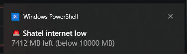

# shatel-monitor

English | [فارسی](#persian)

A small Windows tool that checks how much mobile internet is left on a Shatel Mobile SIM every 30 minutes and shows a Windows notification when it drops below 500 MB.



Unofficial. Not affiliated with or endorsed by Shatel Mobile. It calls the same endpoint the my.shatelmobile.ir self-care page uses, so it can break whenever that site changes.

## Requirements

- Windows 10 or 11 with Windows PowerShell 5.1 and the built-in `curl.exe` (both ship with Windows)
- A Shatel Mobile self-care account

## Setup

1. Clone or download this folder.
2. Log in at https://my.shatelmobile.ir, open DevTools (F12) → Application → Cookies → `https://my.shatelmobile.ir`, and copy the value of the `session` cookie into a file named `session.txt` in this folder.
3. Put your number (as shown in the self-care number selector, without the leading 0, e.g. `9xxxxxxxxx`) into `msisdn.txt`.
4. Check it works. This forces an alert, so you should see a notification:
   ```powershell
   powershell -ExecutionPolicy Bypass -File .\check.ps1 -ThresholdMB 999999
   ```
5. Install the scheduled task:
   ```powershell
   powershell -ExecutionPolicy Bypass -File .\install.ps1
   ```

`session.txt`, `msisdn.txt` and `log.txt` are git-ignored. The session cookie is a login credential: don't share it.

## What it does

- Runs every 30 minutes, plus 2 minutes after you sign in to Windows. It runs on battery too and catches up after sleep.
- Sums `remained` across all your active internet packages.
- **🚨 Shatel internet low**: total is below the threshold (500 MB by default).
- **❌ Shatel check failed**: the server couldn't be reached, or the session expired. For the second, copy a fresh `session` cookie into `session.txt`.
- Appends one line per run to `log.txt`.

Notifications need a signed-in desktop session, so nothing runs while the PC is off or nobody is signed in.

## Options

```powershell
.\check.ps1 -ThresholdMB 1000   # different threshold, for a manual run
.\check.ps1 -SelfTest           # checks the MB/GB/KB parsing
```

To change the threshold for the scheduled task, change the default in `check.ps1`.

## Uninstall

```powershell
Unregister-ScheduledTask 'Shatel Remaining Check' -Confirm:$false
```

## API notes

`POST https://my.shatelmobile.ir/remained` with headers `X-Requested-With: XMLHttpRequest`, `Content-Type: application/json`, cookie `session=<token>` and body `{"msisdn":"<number>"}`. A GET returns 404 and a POST without the body returns 500. The response JSON has `credit`, `internet_packages[]` (`name`, `remained`, `expire`, `status`, ...) and the same for SMS and voice. Sizes are strings with Persian units, e.g. `"10,240 مگابایت"`.

## License

MIT

---

<a id="persian"></a>
<div dir="rtl">

## راهنمای فارسی

یک ابزار کوچک برای ویندوز که هر ۳۰ دقیقه حجم باقی‌ماندهٔ اینترنت سیم‌کارت شاتل موبایل را بررسی می‌کند و وقتی از ۵۰۰ مگابایت کمتر شد، یک اعلان ویندوز نشان می‌دهد.

این ابزار غیررسمی است و هیچ ارتباطی با شاتل موبایل ندارد. از همان آدرسی استفاده می‌کند که صفحهٔ my.shatelmobile.ir استفاده می‌کند، پس اگر سایت تغییر کند ممکن است از کار بیفتد.

### پیش‌نیازها

- ویندوز ۱۰ یا ۱۱ (‏Windows PowerShell 5.1 و `curl.exe` همراه ویندوز هستند)
- حساب کاربری در سامانهٔ خودخدمت شاتل موبایل

### راه‌اندازی

۱. این پوشه را دانلود یا clone کنید.

۲. وارد https://my.shatelmobile.ir شوید، DevTools را باز کنید (F12) و از مسیر Application ← Cookies ← `https://my.shatelmobile.ir` مقدار کوکی `session` را کپی کنید و در فایلی به نام `session.txt` در همین پوشه بگذارید.

۳. شمارهٔ خود را بدون صفر اول (مثلاً `9xxxxxxxxx`) در فایل `msisdn.txt` بنویسید.

۴. برای آزمایش، این دستور را اجرا کنید. باید یک اعلان ببینید:

```powershell
powershell -ExecutionPolicy Bypass -File .\check.ps1 -ThresholdMB 999999
```

۵. وظیفهٔ زمان‌بندی‌شده را نصب کنید:

```powershell
powershell -ExecutionPolicy Bypass -File .\install.ps1
```

کوکی `session` مثل رمز عبور است؛ آن را با کسی به اشتراک نگذارید. فایل‌های `session.txt`، `msisdn.txt` و `log.txt` در git نادیده گرفته می‌شوند.

### چه کار می‌کند

- هر ۳۰ دقیقه، و ۲ دقیقه بعد از ورود به ویندوز اجرا می‌شود؛ روی باتری هم کار می‌کند و بعد از Sleep، بررسی جاافتاده را انجام می‌دهد.
- **🚨 Shatel internet low**: مجموع حجم باقی‌مانده کمتر از حد تعیین‌شده است (پیش‌فرض ۵۰۰ مگابایت).
- **❌ Shatel check failed**: سرور در دسترس نبود یا نشست منقضی شده است. در حالت دوم، کوکی `session` تازه را در `session.txt` بگذارید.
- نتیجهٔ هر اجرا در `log.txt` ثبت می‌شود.

اعلان فقط وقتی نشان داده می‌شود که وارد ویندوز شده باشید؛ وقتی کامپیوتر خاموش است چیزی اجرا نمی‌شود.

### حذف

```powershell
Unregister-ScheduledTask 'Shatel Remaining Check' -Confirm:$false
```

</div>
